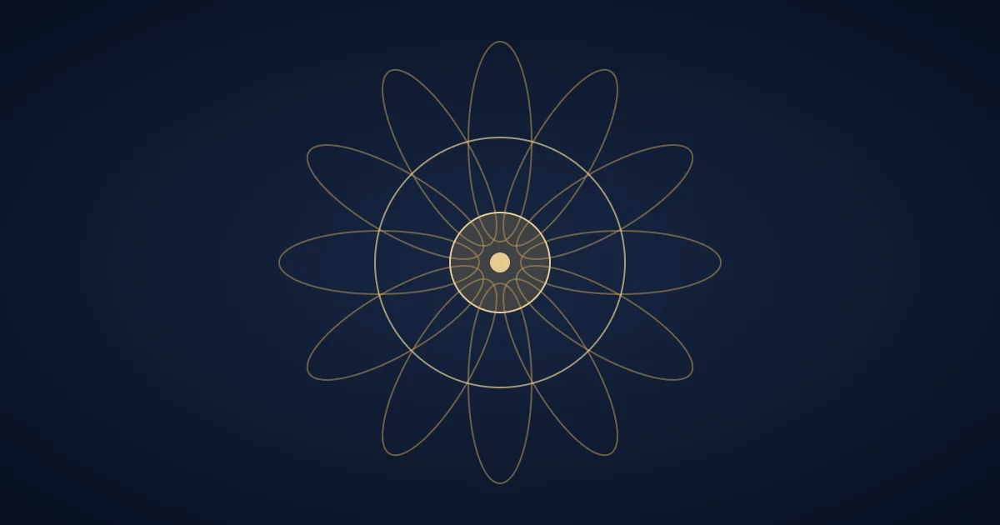

# What is the Panchang?

The **Panchang** is the traditional Vedic almanac. The word means *five limbs*, and each limb describes one aspect of the day. Families commonly consult it before naming ceremonies, griha pravesh, weddings and other poojas.

## The Five Limbs

| Limb | Meaning | What it describes |
| --- | --- | --- |
| Tithi | Lunar day | Phase of the Moon |
| Vaar | Weekday | Ruling planet of the day |
| Nakshatra | Lunar mansion | Position of the Moon among the stars |
| Yoga | Sun-Moon combination | Quality of the time |
| Karana | Half of a Tithi | Suitability for activities |

### How families use it

1. Note the date you wish to hold the ceremony.
2. Check the Tithi and Nakshatra for that day.
3. Avoid periods traditionally marked as inauspicious.
4. Confirm the final *muhurta* with your pandit.

## A Traditional Reminder

> Timing is considered an offering in itself. A ceremony begun with care and sincerity matters more than a perfect calendar.

## Things to Remember

- The Panchang differs slightly by region and location.
- Sunrise time changes the start of the day, so use a local almanac.
- A pandit can interpret it for your family's circumstances.

Here is a tiny example of how a date might be written in a family planner:

```text
2026-11-11 | Wednesday | Muhurta: confirm with pandit
```



For ceremony planning, you can [get in touch](/talk-to-us) or read the [Vedic Almanac overview](https://en.wikipedia.org/wiki/Hindu_calendar) for background. This article is educational and does not promise any specific outcome.
